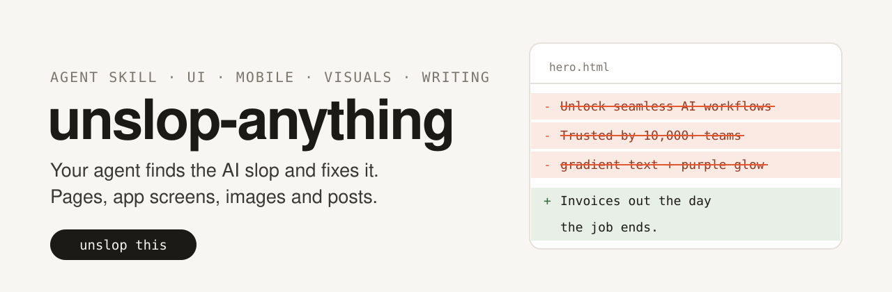
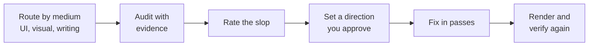

<p align="center">
  
</p>

<p align="center">
  <a href="LICENSE"></a>
  
  
</p>

An agent skill that removes AI slop from anything: web pages, dashboards, landing pages, mobile app screens, product illustrations and demos, images, icons, slides and writing.

Install it and tell your agent "unslop this". The skill makes the agent find every sign of slop, rate how bad it is, set a direction that belongs to your product, fix the work pass by pass and check the result on a real render. The agent does the work. You only answer what the material cannot tell it.

## Install

```bash
npx skills add Pacheche/unslop-anything -g -y
```

Or clone it into your agent's skills folder:

| Agent | Folder |
|---|---|
| Claude Code | `~/.claude/skills/unslop-anything` |
| Codex | `~/.codex/skills/unslop-anything` |
| Copilot CLI, Gemini CLI, others | `~/.agents/skills/unslop-anything` |

```bash
git clone https://github.com/Pacheche/unslop-anything.git ~/.claude/skills/unslop-anything
```

If your agent does not load skills, open this folder and ask it to follow `SKILL.md`. `AGENTS.md` already points there.

## Use

```text
/unslop-anything this dashboard
unslop the hero of https://example.com
is this landing page AI slop? don't change anything
unslop this X thread before I post it
make these app icons look less generated
```

## How it works



## What it does

- **Routes by medium.** UI (web and mobile), visual design, product illustrations and demos, or writing. The agent loads only the rules it needs.
- **Audits with evidence.** Every sign comes with where it lives and its fix: a file and line, a screen region or a quoted sentence.
- **Rates the slop.** Ten categories per medium, 10% each. Heavy slop gets the full process, light slop gets polish only, clean work is left alone.
- **Sets a direction first.** Product, character, world, moments and one signature detail, derived from your product, never from trends. For new looks it compares three directions before committing, and waits for your OK.
- **Fixes what weighs most first.** On landing pages: the headline, something real at the top, then the metadata and builder leftovers that automated scores punish most.
- **Fixes in passes.** UI: spacing, color, icons, copy, type, layout, details, visuals, motion, metadata. Writing: voice-preserving minimum edits.
- **Owns its values.** A type and spacing scale derived from your text, fonts chosen with a reason, decisions saved in `DESIGN.md` so the next prompt does not drift back. It never ships a skill's example values, its own included.
- **Verifies.** Renders again, re-scans, runs the checklist and the template test: if a competitor's name fits your screen or your post, it is not done.
- **Never invents.** No new features, numbers, testimonials or sources. Unverifiable claims go back to you.

## Scanner

`scripts/slop_scan.py` finds candidate signs in code (HTML, CSS, JSX, TSX, Vue, Svelte) and in text. About 95 rules, covering every pattern of the antiwebslop.com catalog that shows in code: color and glow tells, stock fonts and type scale problems, icon tiles, template copy, made-up proof, builder fingerprints (Lovable, v0, Bolt), default metadata, recipes copied from other anti-slop skills, skipped headings, primitive-shape SVG scenes, bounce easing and more. Writing rules cover Markdown and plain text in English, Spanish and Portuguese. Python 3, no dependencies.

```bash
python3 scripts/slop_scan.py src/
python3 scripts/slop_scan.py --text draft.md
python3 scripts/slop_scan.py --json src/ > slop.json
python3 -I scripts/test_slop_scan.py
```

It reports candidates, not verdicts. Zero hits does not mean zero slop: hierarchy, rhythm and meaning still need a render and a reader.

## Structure

```text
SKILL.md                         entry point and routing
references/ui-signs.md           UI signs in ten categories, with fixes and false positives
references/ui-passes.md          the passes, spacing to metadata, with starting values and a checklist
references/direction.md          how to decide what the product should look like
references/mobile.md             iOS and Android specifics
references/component-vocabulary.md  precise names for overlays and controls
references/visual-design.md      images, illustrations, icons, slides, logos, prompt recipe
references/product-illustrations.md  faux product UI: framing, restraint, bento grids, demo motion, review
references/writing.md            writing signs and the voice-preserving edit
scripts/slop_scan.py             candidate finder for code and text
```

## License

MIT
